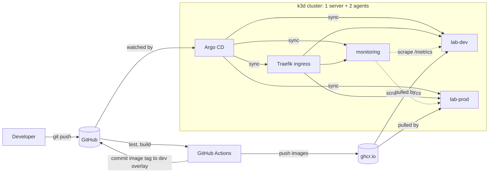

# k8s-gitops-lab

A GitOps-managed Kubernetes platform that runs on a laptop. A three-node k3d cluster runs Argo CD, which deploys an
Angular frontend and a Node.js API to `dev` and `prod` straight from this repository, together with the ingress
controller and a Prometheus/Grafana monitoring stack. GitHub Actions tests and builds the images, and promotion to
prod is a reviewed pull request.

I built it to practise how a platform team runs workloads on Kubernetes: declarative configuration, pull-based
delivery, zero-downtime rollouts, failure handling and observability.

## Architecture



CI never gets cluster credentials. It only writes to Git, and Argo CD pulls the desired state into the cluster.

## Stack

| Area | Implementation |
|---|---|
| Cluster | k3d 5.9 (k3s v1.35), 1 server and 2 agents, Traefik ingress, metrics-server |
| GitOps | Argo CD 3.5 with the app of apps pattern, automated sync with prune and self-heal, sync waves gated on child app health |
| Configuration | Kustomize `base` with `dev` and `prod` overlays: namespace, replicas, config, ingress host, image tags |
| Workloads | Readiness and liveness probes, requests and memory limits, rolling updates with `maxUnavailable: 0`, graceful shutdown, topology spread, PodDisruptionBudget, HPA in prod, non-root containers with a read-only root filesystem |
| Ingress | Traefik with two replicas, a PodDisruptionBudget and a `preStop` delay, configured through a k3s `HelmChartConfig` |
| CI/CD | Tests, multi-stage Docker builds, immutable `sha-<commit>` tags in GHCR, automatic deploy to dev, PR-based promotion to prod |
| Observability | kube-prometheus-stack installed by Argo CD from Helm, a `ServiceMonitor` for the API, a Grafana dashboard provisioned from a ConfigMap |
| Apps | `apps/api`: Express API with Prometheus metrics. `apps/web`: Angular 22 app served by unprivileged nginx |

## Running it

Requirements: Docker, [k3d](https://k3d.io), kubectl and make. On Windows I use WSL2 (Ubuntu) with Docker Desktop
and run every `make` command inside WSL.

1. Fork the repository and point the manifests at your fork:

   ```bash
   grep -rl "rengorz/k8s-gitops-lab" --exclude-dir=.git . | xargs sed -i 's#rengorz/k8s-gitops-lab#<user>/k8s-gitops-lab#g'
   ```

2. In the repository settings, under Actions > General, allow GitHub Actions to create pull requests.
3. Push to `main`. The `ci` workflow tests the apps, pushes both images to GHCR and commits their tag to the dev
   overlay. The images are labelled with the source repository, so they inherit its public visibility.
4. Create the cluster and hand everything else over to Argo CD:

   ```bash
   make up
   ```

   The first run pulls every image onto three empty nodes and can take 15 to 30 minutes on a slow connection.

| Service | URL |
|---|---|
| App, dev | http://dev.lab.localhost:8080 |
| App, prod | http://prod.lab.localhost:8080 |
| Grafana | http://grafana.lab.localhost:8080 (admin / lab-admin) |
| Argo CD | `make argocd-ui`, then https://localhost:8081 (admin, password printed by `make up`) |

Browsers and curl resolve `*.localhost` to 127.0.0.1. Other clients, such as PowerShell, need the hosts added to
the hosts file.

```text
make help      list targets
make status    Argo CD applications and app pods
make test      api and web unit tests in a Node 22 container
make load      traffic generator, e.g. make load ENV=prod REQUESTS=50000 CONCURRENCY=50
make down      delete the cluster
```

## Demo scenarios

1. **GitOps deploy.** Push a change under `apps/`. CI builds `sha-<commit>`, commits the tag to
   `deploy/overlays/dev`, and Argo CD rolls out `lab-dev`. The page shows the new version and the pod that served it.
2. **Self-heal.** `kubectl -n lab-dev scale deploy/api --replicas=5` is reverted by Argo CD within seconds.
3. **Rollback.** `git revert` the deploy commit and push. Argo CD brings back the previous image.
4. **Promotion.** Run the `promote-to-prod` workflow, review the pull request that copies the dev image tags to prod,
   and merge it. Argo CD rolls out `lab-prod` one pod at a time without failed requests.
5. **Autoscaling.** Run `make load ENV=prod REQUESTS=50000 CONCURRENCY=50` and watch
   `kubectl -n lab-prod get hpa -w` scale the API from 3 to 6 replicas.
6. **Node maintenance.** `kubectl drain <node> --ignore-daemonsets --delete-emptydir-data` while traffic is running.
   The PodDisruptionBudgets evict API and Traefik pods one at a time, and requests keep succeeding.
   Run `kubectl uncordon <node>` afterwards.

## Design decisions

- **Pull-based delivery.** The cluster credentials never leave the cluster, Git is the audit log, and drift is
  corrected automatically.
- **Immutable image tags.** Every deploy references `sha-<commit>`, so the running version is always traceable to a
  commit, and rollback is a `git revert`. Prod receives the exact image that was tested in dev.
- **No CPU limits.** CPU requests drive scheduling and the HPA. Leaving out CPU limits avoids throttling, and the
  memory limit still protects the node.
- **ConfigMaps from a generator.** The content hash in the name triggers a rolling update whenever configuration
  changes.
- **Health-gated sync waves.** Argo CD treats child Applications as healthy as soon as they exist. A custom health
  check in `argocd-cm` makes the apps in wave 1 wait for the monitoring stack and its CRDs.
- **HPA owns prod replicas.** The prod Application ignores `/spec/replicas`, so self-heal does not fight the
  autoscaler.
- **No single point of failure in the request path.** Traefik runs two replicas spread across nodes with a
  PodDisruptionBudget, and its `preStop` delay keeps it serving until it has been removed from Service endpoints.

## Repository layout

```text
apps/api            Express API, tests, Dockerfile
apps/web            Angular app, Dockerfile, nginx config
deploy/base         manifests shared by all environments
deploy/overlays     dev and prod differences
platform/traefik    ingress controller configuration
monitoring          Grafana dashboards as code
argocd/install      pinned Argo CD installation and its config
argocd/root.yaml    app of apps, the only manually applied Application
argocd/apps         Applications: traefik, monitoring, dashboards, lab-dev, lab-prod
scripts             bootstrap, teardown, load test
.github/workflows   ci and promote-to-prod
```

## What I learned

## Next steps

- Secrets managed with Sealed Secrets or External Secrets instead of plain values
- Alerting with PrometheusRules and Alertmanager for error rate, latency and restarts
- Policies with Kyverno that require probes, requests and non-root containers
- A second cluster managed through an Argo CD ApplicationSet
- Backups with Velero to S3-compatible storage, including a restore test
- A local registry mirror so that new nodes do not pull every image from the internet
