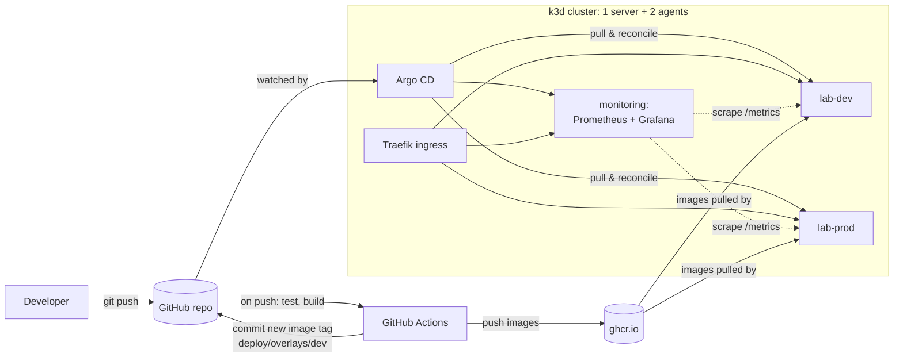

# k8s-gitops-lab

A small but realistic **GitOps-managed Kubernetes platform** running locally: a multi-node k3d cluster where
**Argo CD** deploys an Angular frontend and a Node.js API to `dev` and `prod` environments straight from Git,
with **Prometheus + Grafana** monitoring, CI on **GitHub Actions** and PR-based promotion to prod.

> Built to learn and demonstrate how a platform team runs workloads on Kubernetes:
> declarative config, automated delivery, safe rollouts and observability.

## Architecture



**Pull-based GitOps:** CI never has cluster credentials. It only changes Git; Argo CD pulls and applies.

## What's inside

| Area | Implementation |
|---|---|
| Cluster | [k3d](https://k3d.io) (k3s in Docker), 1 control-plane + 2 worker nodes, Traefik ingress, metrics-server |
| GitOps | Argo CD, **app-of-apps** pattern (`argocd/root.yaml` → `argocd/apps/*`), automated sync with **prune + self-heal**, sync waves |
| Config | **Kustomize** `base` + `overlays/dev` / `overlays/prod` (namespace, replicas, config, ingress host, image tags) |
| Workloads | Deployments with **readiness/liveness probes**, **requests/limits**, rolling updates with `maxUnavailable: 0`, **PodDisruptionBudget**, **HPA** in prod, non-root + read-only root filesystem, graceful shutdown on SIGTERM |
| CI/CD | GitHub Actions: unit tests → multi-stage Docker builds → push to GHCR → bump tag in dev overlay; manual **promote** workflow opens a PR dev → prod |
| Observability | kube-prometheus-stack installed **by Argo CD from Helm**; `ServiceMonitor` for the API; Grafana dashboard provisioned from a ConfigMap (RPS, p95 latency, 5xx, ready pods, memory, restarts) |
| Apps | `apps/api` – Node.js/Express REST API with Prometheus metrics; `apps/web` – Angular SPA served by unprivileged nginx |

## Quick start

Requirements: Docker, [k3d](https://k3d.io/#installation), kubectl. (Optional: helm, kustomize, argocd CLI.)

```bash
# 1. fork/clone, then replace the repo URL if your GitHub user is different
grep -rl "rengorz/k8s-gitops-lab" . | xargs sed -i 's#rengorz/k8s-gitops-lab#<you>/k8s-gitops-lab#g'

# 2. push to GitHub, let the "ci" workflow build images, then make the two GHCR packages public
#    (GitHub → Packages → k8s-gitops-lab-api / -web → Package settings → Change visibility)

# 3. create cluster + Argo CD; everything else is synced from Git
make up
```

| What | URL |
|---|---|
| App – dev | http://dev.lab.localhost:8080 |
| App – prod | http://prod.lab.localhost:8080 |
| Grafana | http://grafana.lab.localhost:8080 (admin / lab-admin) |
| Argo CD | `make argocd-ui` → https://localhost:8081 (admin / printed by `make up`) |

`*.localhost` resolves to 127.0.0.1 in modern browsers and curl. If not, add the hosts to `/etc/hosts`.

## Demo scenarios

1. **GitOps deploy** – change the API, `git push` → CI builds `sha-xxxxxxx` → commits the tag → Argo CD rolls out `lab-dev`.
2. **Self-heal** – `kubectl -n lab-dev scale deploy/api --replicas=5` → Argo CD reverts it to what Git says.
3. **Zero-downtime rollout** – run `make load` while a new version deploys; readiness probes + `maxUnavailable: 0`
   + graceful shutdown keep every request answered.
4. **Promotion** – run the *promote-to-prod* workflow → review/merge the PR → `lab-prod` updates.
5. **Rollback** – `git revert` the deploy commit (or roll back in the Argo CD UI) → previous version returns.
6. **Autoscaling** – generate load against prod and watch `kubectl -n lab-prod get hpa -w`.
7. **Node maintenance** – `kubectl drain <agent-node> --ignore-daemonsets --delete-emptydir-data`; the PDB keeps the
   API available while pods move to the other node; `kubectl uncordon` afterwards.

## Repository layout

```
apps/api            Node.js API (Express, prom-client) + Dockerfile + tests
apps/web            Angular SPA + Dockerfile + nginx.conf
deploy/base         Kubernetes manifests shared by all environments
deploy/overlays     dev / prod differences (Kustomize)
argocd/root.yaml    app of apps (the only manually applied manifest)
argocd/apps         Argo CD Applications: monitoring, dashboards, lab-dev, lab-prod
monitoring          Grafana dashboards as code
scripts             bootstrap / teardown / load test
.github/workflows   ci (build & deploy to dev), promote-to-prod (PR)
```

## What I learned

- _fill in as you go: e.g. why `maxUnavailable: 0` + readiness probes matter, how prune/self-heal change the
  way you operate a cluster, why CRDs need server-side apply, why Argo CD must ignore `replicas` when an HPA owns them…_

## Next steps

- [ ] **Backups**: Velero to MinIO (S3) – schedule namespace backups and test a restore
- [ ] **Secrets**: Sealed Secrets or External Secrets instead of plain values
- [ ] **Multiple clusters**: register a second k3d cluster in Argo CD and use an `ApplicationSet` to deploy to both
- [ ] **Policies**: Kyverno to enforce requests/limits and non-root containers
- [ ] **IaC**: provision the cluster with Terraform/OpenTofu; Ansible for node-level config
- [ ] **Alerting**: PrometheusRules for error rate / pod restarts → Alertmanager
